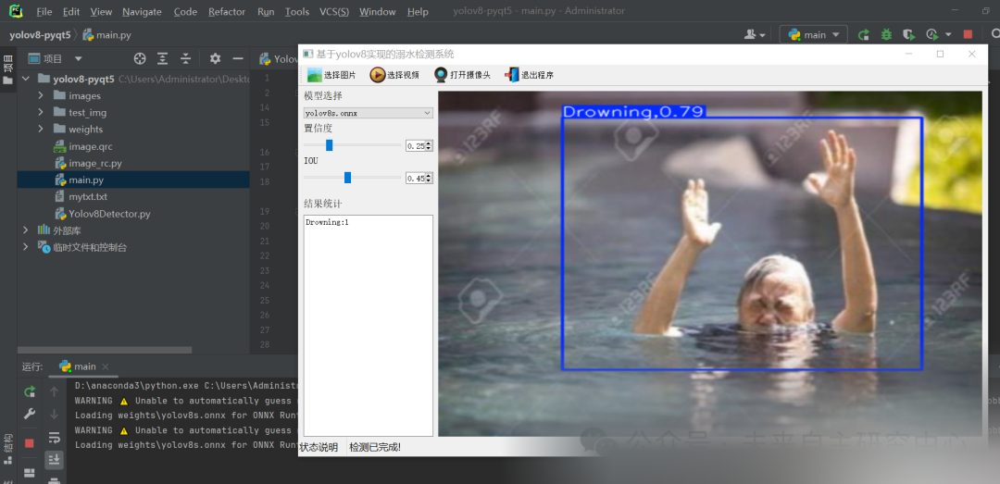

# Yolov8-based Person Drowning Detection and Alarm System with Python Source Code, ONNX Model, Evaluation Indicator Curve, and High-quality GUI Interface

[Algorithm Introduction] The personnel drowning detection and alert monitoring system based on YOLOv8 is an efficient and intelligent safety monitoring solution.

[Algorithm Introduction]

A personnel drowning detection and alert monitoring system based on YOLOv8 is an efficient and intelligent safety monitoring solution. This system utilizes the advanced performance of the YOLOv8 object detection algorithm to achieve precise identification and rapid response to drowning behaviors in water areas.

YOLOv8 inherits the advantages of the YOLO series algorithms, such as single-pass prediction, fast speed, and high accuracy, and further optimizes the model performance and generalization ability. This system can quickly locate people in water through real-time video analysis and accurately judge whether they are in a drowning state in complex environments.

Once the drowning behavior is detected, The system will immediately trigger an alert. Notify the relevant personnel to intervene in time for rescue. Thus, it effectively reduces the occurrence of drowning accidents. At the same time, The system also supports automatic video data collection. Data transmission and intelligent analysis. Provides comprehensive technical support for water body safety management.

In addition, the YOLOv8-based personnel drowning detection and warning monitoring system is highly flexible and scalable. It can be customized for development and deployment based on actual needs, suitable for various waterway scenarios.

[Effect Display]



[Test Environment]

windows10
anaconda3+python3.8
torch==1.9.0+cu111
ultralytics==8.2.70

[Training Dataset]

https://blog.csdn.net/FL1623863129/article/details/140031636

Please note that the model training dataset may differ from the above-mentioned dataset. Originating from the possibility that data set optimization and organization may lead to an increase or decrease in the number of categories or images. Main dataset consistency

The model can detect the category.

Drowning
Person out of water
Swimming

[Partial Implementation Source Code]

-
-
-
-
-
-
-
-
-
-
-
-
-
-
-
-
-
-
-
-
-
-
-
-
-
-
-
-
-
-
-
-
-
-
-
-
-
-
-
-
-
-
-
-
-
-
-
-
-
-
-
-
-
-
-
-
-
-
-
-
-
-
-
-
-
-
-
-
-
-
-
-
-
-
-
-
-
-
-
-
-
-
-
-
-
-
-
-
-
-
-
-
-
-
-
-
-
-
-
-
-
-
-
-
-
-
-
-

```
class Ui_MainWindow(QtWidgets.QMainWindow):    signal = QtCore.pyqtSignal(str, str)     def setupUi(self):        self.setObjectName("MainWindow")        self.resize(1280, 728)        self.centralwidget = QtWidgets.QWidget(self)        self.centralwidget.setObjectName("centralwidget")         self.weights_dir = './weights'         self.picture = QtWidgets.QLabel(self.centralwidget)        self.picture.setGeometry(QtCore.QRect(260, 10, 1010, 630))        self.picture.setStyleSheet("background:black")        self.picture.setObjectName("picture")        self.picture.setScaledContents(True)        self.label_2 = QtWidgets.QLabel(self.centralwidget)        self.label_2.setGeometry(QtCore.QRect(10, 10, 81, 21))        self.label_2.setObjectName("label_2")        self.cb_weights = QtWidgets.QComboBox(self.centralwidget)        self.cb_weights.setGeometry(QtCore.QRect(10, 40, 241, 21))        self.cb_weights.setObjectName("cb_weights")        self.cb_weights.currentIndexChanged.connect(self.cb_weights_changed)         self.label_3 = QtWidgets.QLabel(self.centralwidget)        self.label_3.setGeometry(QtCore.QRect(10, 70, 72, 21))        self.label_3.setObjectName("label_3")        self.hs_conf = QtWidgets.QSlider(self.centralwidget)        self.hs_conf.setGeometry(QtCore.QRect(10, 100, 181, 22))        self.hs_conf.setProperty("value", 25)        self.hs_conf.setOrientation(QtCore.Qt.Horizontal)        self.hs_conf.setObjectName("hs_conf")        self.hs_conf.valueChanged.connect(self.conf_change)        self.dsb_conf = QtWidgets.QDoubleSpinBox(self.centralwidget)        self.dsb_conf.setGeometry(QtCore.QRect(200, 100, 51, 22))        self.dsb_conf.setMaximum(1.0)        self.dsb_conf.setSingleStep(0.01)        self.dsb_conf.setProperty("value", 0.25)        self.dsb_conf.setObjectName("dsb_conf")        self.dsb_conf.valueChanged.connect(self.dsb_conf_change)        self.dsb_iou = QtWidgets.QDoubleSpinBox(self.centralwidget)        self.dsb_iou.setGeometry(QtCore.QRect(200, 160, 51, 22))        self.dsb_iou.setMaximum(1.0)        self.dsb_iou.setSingleStep(0.01)        self.dsb_iou.setProperty("value", 0.45)        self.dsb_iou.setObjectName("dsb_iou")        self.dsb_iou.valueChanged.connect(self.dsb_iou_change)        self.hs_iou = QtWidgets.QSlider(self.centralwidget)        self.hs_iou.setGeometry(QtCore.QRect(10, 160, 181, 22))        self.hs_iou.setProperty("value", 45)        self.hs_iou.setOrientation(QtCore.Qt.Horizontal)        self.hs_iou.setObjectName("hs_iou")        self.hs_iou.valueChanged.connect(self.iou_change)        self.label_4 = QtWidgets.QLabel(self.centralwidget)        self.label_4.setGeometry(QtCore.QRect(10, 130, 72, 21))        self.label_4.setObjectName("label_4")        self.label_5 = QtWidgets.QLabel(self.centralwidget)        self.label_5.setGeometry(QtCore.QRect(10, 210, 72, 21))        self.label_5.setObjectName("label_5")        self.le_res = QtWidgets.QTextEdit(self.centralwidget)        self.le_res.setGeometry(QtCore.QRect(10, 240, 241, 400))        self.le_res.setObjectName("le_res")        self.setCentralWidget(self.centralwidget)        self.menubar = QtWidgets.QMenuBar(self)        self.menubar.setGeometry(QtCore.QRect(0, 0, 1110, 30))        self.menubar.setObjectName("menubar")        self.setMenuBar(self.menubar)        self.statusbar = QtWidgets.QStatusBar(self)        self.statusbar.setObjectName("statusbar")        self.setStatusBar(self.statusbar)        self.toolBar = QtWidgets.QToolBar(self)        self.toolBar.setToolButtonStyle(QtCore.Qt.ToolButtonTextBesideIcon)        self.toolBar.setObjectName("toolBar")        self.addToolBar(QtCore.Qt.TopToolBarArea, self.toolBar)        self.actionopenpic = QtWidgets.QAction(self)        icon = QtGui.QIcon()        icon.addPixmap(QtGui.QPixmap(":/images/1.png"), QtGui.QIcon.Normal, QtGui.QIcon.Off)        self.actionopenpic.setIcon(icon)        self.actionopenpic.setObjectName("actionopenpic")        self.actionopenpic.triggered.connect(self.open_image)        self.action = QtWidgets.QAction(self)        icon1 = QtGui.QIcon()        icon1.addPixmap(QtGui.QPixmap(":/images/2.png"), QtGui.QIcon.Normal, QtGui.QIcon.Off)        self.action.setIcon(icon1)        self.action.setObjectName("action")        self.action.triggered.connect(self.open_video)        self.action_2 = QtWidgets.QAction(self)        icon2 = QtGui.QIcon()        icon2.addPixmap(QtGui.QPixmap(":/images/3.png"), QtGui.QIcon.Normal, QtGui.QIcon.Off)        self.action_2.setIcon(icon2)        self.action_2.setObjectName("action_2")        self.action_2.triggered.connect(self.open_camera)         self.actionexit = QtWidgets.QAction(self)        icon3 = QtGui.QIcon()        icon3.addPixmap(QtGui.QPixmap(":/images/4.png"), QtGui.QIcon.Normal, QtGui.QIcon.Off)        self.actionexit.setIcon(icon3)        self.actionexit.setObjectName("actionexit")        self.actionexit.triggered.connect(self.exit)         self.toolBar.addAction(self.actionopenpic)        self.toolBar.addAction(self.action)        self.toolBar.addAction(self.action_2)        self.toolBar.addAction(self.actionexit)         self.retranslateUi()        QtCore.QMetaObject.connectSlotsByName(self)        self.init_all()
```

[Usage Steps]

Usage Steps:
1. First, install the YOLOv8 environment according to the official framework https://github.com/ultralytics/ultralytics and PyQt5 installation tutorial.
2. After switching to your installed YOLOv8 environment, navigate to the source code directory and execute python main.py to start the interface for operation.

[Provided Files]

Python source code
YOLOv8s.onnx model (No PyTorch model provided; if you need a PyTorch model, please download the dataset and train it yourself from https://blog.csdn.net/FL1623863129/article/details/140031636)
Training map, P, R curve graph (in weights\results.png)
Test images (under test_img folder)

[Video demonstration]

Based on YOLOv8, a person drowning detection and alert monitoring system in Python source code + ONNX model + evaluation indicator curve + exquisite GUI interface - Bilibili [Test Environment] Windows 10 Anaconda 3 + Python 3.8 torch == 1.9.0 + cu111 ultralytics == 8.2.70 More information refer to the blog: https://blog.csdn.net/FL1623863129/article/details/141630856 Video playback volume 1. No concurrent comments. 0 likes. Coins thrown 0. 0 collectors. No shares forwarded.Video Author: Future Autonomous Research Center, Biography: Future Autonomous Research Center, Related Videos: C# Deploying YOLOv8-ONNX Image Classification Model with Pure OpenCVSharp, YOLOv8 Detection Interface - PyQt5 Implementation, Introduction to Encryption and Decryption of Deep Learning Models Based on ONNX Models, Deployment of YOLOv8 Object Detection Model ONNX with Pure OpenCV, [Course][Original] Course Outline: Yolov8 Detection Encapsulated into a Class Calling a Few Lines of Code to Complete Object Detection Tasks, Rotating Boxes of Yolov8 Encapsulated into a Class with a Few Lines of Code to Complete Rotating Object Detection, C++ Version Yolov8 ONNX Model Encryption Method to Protect Your Model and Copyright.Demo of the algorithm results based on C# for Winform YOLOv8-ONNX + ByteTrack target tracking. This guide will teach you how to train your own dataset using YOLOv8 (principles and code practice). Video demonstration based on the official YOLOv8 target tracking botsort and bytetrack source code https://www.bilibili.com/video/BV1bjsKeXEri/


## Payment

Here is a pay link on Stripe ( https://buy.stripe.com/3cs8yP7sY87d0vu9AB ). Please contact me lonlonago@foxmail.com after funding $89, and I will send you a complete data files , thank you!


